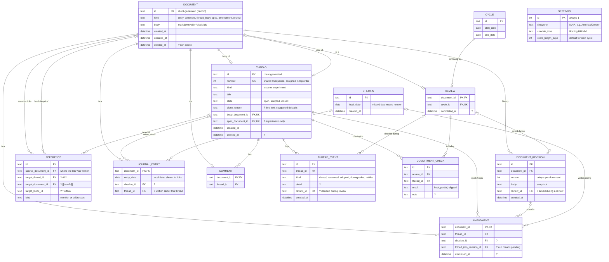

# LifeLab ERD (draft)

> **Drafted by Claude (Opus 5.5)** on 2026-11-19 from design decisions Vin made in conversation.
> Open questions at the bottom are Vin's to resolve.

LifeLab uses [LiveStore](https://github.com/livestorejs/livestore): an **append-only event log is the system of record**, and the SQL tables below are a **read model** that LiveStore's materializers rebuild from the log on every client (browser SQLite via WebAssembly, with FTS5) and on the server (Node). Single user, self-hosted on a tailnet, one store per user. `?` in a comment means nullable.

The central idea of the read model is a **`DOCUMENT` supertable**: every piece of markdown (journal entry, comment, issue/experiment body, experiment spec, amendment, review) is a row in `DOCUMENT`, and the specific tables share its primary key (class-table inheritance). Search, references, block IDs, revision history, and soft delete are each implemented once, on `DOCUMENT`.

## System of record: the event log

| Column | Type | Notes |
|---|---|---|
| `seq` | int | global order, assigned by the sync backend |
| `parent_seq` | int | the event this client saw last (push is rejected if stale; the client rebases) |
| `name` | text | e.g. `v1.ThreadOpened` |
| `args` | json | event payload |
| `client_id`, `session_id` | text | which device/tab |
| `created_at` | datetime | |

Event catalog (first pass, versioned names so the schema can evolve):

| Event | Payload (abridged) | Materializes into |
|---|---|---|
| `EntryCreated` | id, entryDate, body, checkinId?, threadId? | `document`, `journal_entry`, `reference` |
| `DocumentEdited` | documentId, body | `document`, `document_revision`, `reference` |
| `DocumentDeleted` | documentId | `document.deleted_at` |
| `ThreadOpened` | id, kind, title, bodyDocId, body | `thread` (number assigned in log order), `document` |
| `ThreadRetitled` / `ThreadClosed` / `ThreadReopened` | threadId, title / reason | `thread`, `thread_event` |
| `SpecCreated` | threadId, specDocId, body | `document`, `thread.spec_document_id` |
| `CommentAdded` | id, threadId, body | `document`, `comment` |
| `AmendmentAdded` | id, threadId, body, checkinId? | `document`, `amendment` |
| `AmendmentsFolded` | threadId, revisionBody, amendmentIds, reviewId? | `document_revision`, `amendment.folded_into_revision_id` |
| `AmendmentDismissed` | amendmentId | `amendment.dismissed_at` |
| `ExperimentAdopted` / `ExperimentDowngraded` | threadId, reviewId? | `thread.state`, `thread_event` |
| `CheckinStarted` | id, localDate | `checkin` |
| `CycleStarted` / `CycleEndChanged` | id, start, end | `cycle` |
| `ReviewStarted` / `ReviewCompleted` | id, cycleId, body | `document`, `review` |
| `CommitmentChecked` | reviewId, threadId, result, note? | `commitment_check` |
| `SettingsChanged` | timezone?, checkinTime?, cycleLengthDays? | `settings` |

Push subscriptions are device-local secrets for the server, so they live in a small server-side table, not in the synced log.

## Read model

FTS5: one virtual table `document_fts` over `DOCUMENT.body` searches everything at once. LiveStore ships an FTS5-enabled wa-sqlite build (`@livestore/wa-sqlite/dist/fts5/`).

## Key design choices

- **IDs are client-generated strings (nanoid), not autoincrement integers.** Events are created on whichever device you're using before the server orders them, so the database cannot hand out IDs.
- **`THREAD.number` is assigned by the materializer in log order.** Every client replays the same order, so every client computes the same numbers. A thread created on two devices at the same moment could have its number change once after sync (shown as provisional until synced); references store `thread_id`, so links survive.
- **`THREAD` holds both issues and experiments** (single-table inheritance, like a GitHub PR being an issue). A commitment is an experiment with `state = 'adopted'`.
- **`DOCUMENT` is a supertype** for everything containing markdown. A reference's source is always a real foreign key.
- **Spec revisions are `DOCUMENT_REVISION` rows of the experiment's spec document**, and every other document gets edit history for free. No revision messages for now.
- **Pending amendment** = `folded_into_revision_id IS NULL AND dismissed_at IS NULL` (and its document not deleted).
- **Blocks have no table.** Block IDs live in the markdown (`^k3f9a2`, Obsidian-style).
- **The timeline comes from the log and the read model:** state changes in `THREAD_EVENT`, plus comments, revisions, amendments, and backlinks by timestamp.
- **Cycles are stored rows**, so changing the cadence never moves past cycles. Experiments relate to cycles by date overlap.
- **"What was I doing on day X?"** can be answered from the read model (latest revision as of X plus amendments pending at X) or by replaying the log up to X.

## Invariants and where they are enforced

With event sourcing, materializers must be deterministic and cannot reject events, so rules are checked **before an event is committed** (the command layer), against the current read model.

| Rule | Enforcement |
|---|---|
| Only experiments can be adopted or have a spec | command layer; `CHECK` on the read-model table as a backstop |
| Exactly one target per reference | `CHECK` on `REFERENCE` (references are derived by parsing markdown) |
| Adopting requires zero pending amendments | the adopt flow emits `AmendmentsFolded` / `AmendmentDismissed` for every leftover, then `ExperimentAdopted`, committed together; the command refuses to adopt otherwise |
| Version numbers unique per document | assigned by the materializer; `UNIQUE(document_id, version)` |
| One review per cycle | command layer; `UNIQUE(cycle_id)` on `REVIEW` |

## Resolved (Vin's decisions)

- **Storage and sync: LiveStore** (event sourcing, reactive SQLite on each client), TypeScript throughout.
- **Typed links, GitHub-style:** a plain `#12` is a `mention`; `addresses #12` creates an `addresses` link. Adopting an experiment opens a checklist: "close these addressed issues?"
- **Spec revisions are separate from the thread body.** Editing an adopted commitment's spec is allowed. The experiment's full view shows the whole revision timeline, including amendments and when each was folded or dismissed.
- **Leftover amendments:** saving a spec edit nudges you to fold pending amendments but does not block the save. Folding and dismissing are the only ways an amendment closes.
- **Adoption requires a clean spec:** zero pending amendments.
- **No uniqueness on check-in entries.**
- **Changing the cadence mid-cycle asks the user** whether it applies to the current cycle or starts with the next one (if applying it now would end the cycle in the past, end it today).
- **Close reasons:** free text with suggested defaults (abandoned, inconclusive, superseded by #N).

## Open questions (Vin to resolve)

- Which sync backend runs on the tailnet (see the system design).
- When does a save create a `DOCUMENT_REVISION`: every `DocumentEdited` event, or coalesced edits (e.g. the editor emits one event per pause in typing)?
