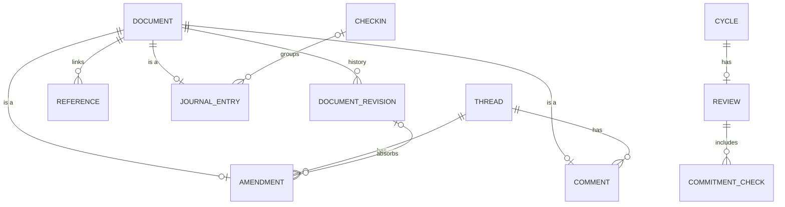
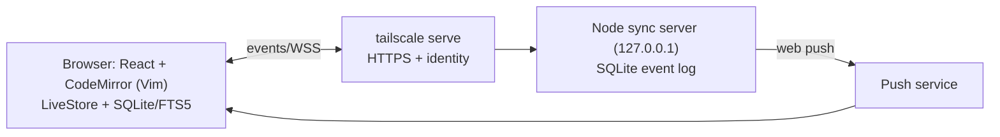

# LifeLab — Initial Design (short)
*Drafted by Claude (Opus 5.5) from Vin's design decisions. Full version: [initial-design.md](initial-design.md).*

**What:** Self-hosted journal + GitHub-style self-improvement loop. Journal → open **issues** (quoting journal blocks) → run **experiments** → daily **check-ins** (one-line **amendments**) → biweekly **review**: fold amendments into the spec, **adopt** as a commitment or close.

**Goals:** structure without rigidity; low-friction check-ins; everything links with backlinks; single user, on my tailnet.

## ERD (read model; LiveStore event log is the source of truth)

`THREAD` = issues + experiments (shared `#number`). Details: [erd.md](erd.md)

## System

Security: tailnet-only, Tailscale identity header, localhost bind. Scale: one store per user. Cost: $0.

## Daily goals
- 11/20–21: scaffold LiveStore; journal editor
- 11/23–24: issues/experiments + links; custom sync server
- 11/25–28: deploy on tailnet (light, Thanksgiving)
- 11/30–12/2: amendments, check-ins + push, reviews
- 12/3–5: timeline, search, block picker, buffer
- 12/7–10: demo, report, submit
