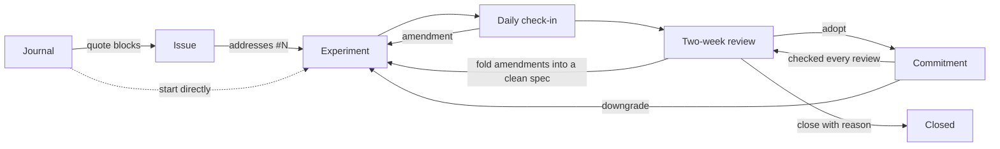
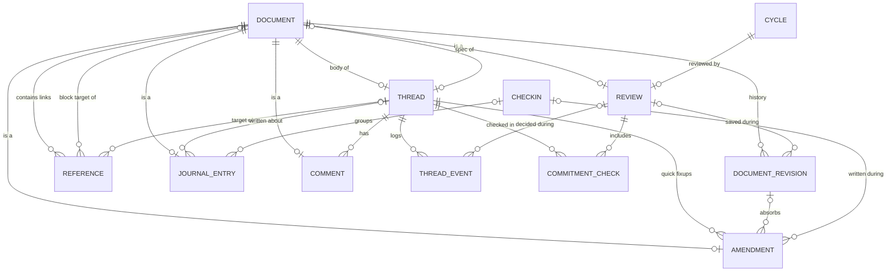
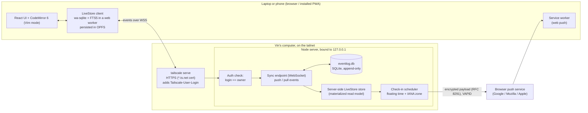

# LifeLab: Initial Design

> **Authorship:** The product idea and every design decision below are Vin's, made in a design conversation on 2026-11-19. The text and diagrams were **drafted by Claude (Opus 5.5)** from that conversation and reviewed by Vin. The daily goals are a Claude draft for Vin to adjust.

## What LifeLab is

LifeLab is a self-hosted journaling app built around a **self-improvement loop borrowed from software development**. You journal. When you notice something you want to do better, you open an **issue** (like a GitHub issue), quoting the journal passages that prompted it. You then run **experiments** against your issues for a while, check in on them **daily**, and every two weeks you hold a **review** where experiments that work are **adopted** as **commitments** and the rest are closed.

### Goals

- **Structure without rigidity.** The loop is a path you can fall into, never a form you must fill in order. You can start an experiment without an issue, write an amendment without editing anything, and skip a check-in. Everything is additive.
- **Low-friction daily check-ins.** Saying "this didn't work, I'll try it on weekdays only" takes one line (an **amendment**). Cleanup happens at review time, like squashing git fixup commits.
- **Everything links.** Issues, experiments, comments, and journal blocks reference each other GitHub-style (`#12`, `[[2026-11-19/k3f9a2#^b7x]]`), and every target shows its backlinks in a timeline.
- **Yours, on your machine.** Single user, self-hosted on a Tailscale network, no third-party storage.

### The loop

### Core concepts

| Concept | What it is | GitHub analogy |
|---|---|---|
| Journal entry | Free-form markdown; paragraphs get block IDs (`^b7x`) so they can be quoted | (none; Obsidian-style blocks) |
| Issue | Something you want to do better; open or closed with a reason | Issue |
| Experiment | A concrete change you try, with a versioned **spec**; can address several issues | Pull request (they share one `#number` sequence) |
| Amendment | A one-line change to an experiment, in effect immediately, folded into the spec later | `git commit --fixup` |
| Daily check-in | A daily web push at a fixed local time; journal per experiment, add amendments | Standup |
| Review | Every cycle (default two weeks, configurable): fold amendments, adopt or close experiments, check commitments | Sprint review |
| Commitment | An adopted experiment, checked at every review; can be downgraded | Merged PR |

## Initial ERD

LifeLab is **event-sourced** with [LiveStore](https://github.com/livestorejs/livestore). An append-only **event log** is the system of record (`ThreadOpened`, `AmendmentAdded`, `AmendmentsFolded`, `ExperimentAdopted`, …). The tables below are the **read model** that LiveStore materializes from the log into SQLite on every device. Full column lists, types, the event catalog, and the invariants are in **[erd.md](erd.md)**.

Highlights:

- **`DOCUMENT` supertable:** every piece of markdown (entry, comment, thread body, spec, amendment, review) is a document, so search (one FTS5 index), references, block IDs, revision history, and soft delete are implemented once.
- **`THREAD`** holds both issues and experiments, the way a GitHub PR is an issue; a commitment is an experiment with `state = 'adopted'`.
- **A pending amendment** is one with `folded_into_revision_id IS NULL AND dismissed_at IS NULL`; adopting requires none to be pending.
- **Client-generated IDs:** events are created on whichever device you're using before the server orders them, so IDs are nanoids, and the `#number` is assigned by the materializer in log order.

## Rough system design

### Technology choices

- **TypeScript everywhere.** One language across the editor, LiveStore schema, and server.
- **LiveStore (event sourcing + reactive SQLite).** Every open tab and device updates live. "Purely additive" is literally how the data is stored, and "what was I doing on day X?" is a replay of the log.
- **Custom Node sync server.** LiveStore's official sync backends need Cloudflare, Postgres (Electric), or a hosted service (S2). LifeLab implements LiveStore's `SyncBackend` interface (`connect`, `pull`, `push`) against a WebSocket server that appends to a SQLite event log.
- **SQLite + FTS5.** Single user, embedded, zero-ops; FTS5 provides full-text search over all documents.
- **CodeMirror 6 with Vim bindings** for every editor; its markdown parser also finds block IDs and links.
- **Tailscale Serve** for HTTPS and identity; **Web Push** for the daily check-in.

### Security boundaries

1. **Tailnet boundary.** The app is reachable only by devices on Vin's tailnet; nothing is exposed to the public internet (no Funnel).
2. **Identity.** `tailscale serve` injects `Tailscale-User-Login` and strips any client-supplied copy. The server accepts only the owner's login.
3. **Localhost bind.** The Node server listens on `127.0.0.1` only, so the identity header can't be spoofed by connecting to it directly.
4. **One outbound flow.** Web push is the only traffic that leaves the tailnet; payloads are end-to-end encrypted (RFC 8291), so the push service can't read them.
5. **Accepted risks (documented, out of scope).** Data is not encrypted at rest (like Obsidian), and every signed-in device keeps a full local copy in browser storage, so a lost unlocked device exposes the journal.

### Concurrency

The sync server gives every event a global sequence number. A push whose `parent_seq` is behind the head is rejected, and the client **rebases** its pending events on top of the new ones and retries (optimistic concurrency). Materializers are deterministic, so every device ends up with the same read model. Invariants (e.g. "adopting requires zero pending amendments") are checked before events are committed, because materializers can't reject events.

### Scaling and cost

- **Scaling:** one user per store, and SQLite's single writer matches that exactly. A hosted multi-user version would use **one event log and store per user** (the database-per-tenant pattern used by Turso and Cloudflare D1/Durable Objects), which scales horizontally because users never share data.
- **Cost:** $0/month. It runs on a computer Vin already owns; Tailscale's personal plan and browser push services are free. Future work: backups of `eventlog.db` (e.g. Litestream or a nightly copy), since the log is the only thing that must survive.

## Initial daily goals (draft for Vin to adjust)

| Date | Goal |
|---|---|
| Thu 11/19 | Initial design; data modeling and system design interviews; pitch |
| Fri 11/20 | Scaffold Vite + React + TS + LiveStore (local only); event schema v1 and materializers for documents and journal entries; load the FTS5 wa-sqlite build |
| Sat 11/21 | Journal UI: CodeMirror 6 with Vim mode, create and edit entries, block IDs |
| Mon 11/23 | Issues and experiments: shared `#number`, comments, markdown reference parser, backlinks |
| Tue 11/24 | Custom sync server: WebSocket push/pull, SQLite event log, stale-push rejection; client `SyncBackend` |
| Wed 11/25 – Sat 11/28 | Thanksgiving (light): deploy behind `tailscale serve` with header auth; test sync between two devices |
| Mon 11/30 | Experiment specs, revisions, amendments, fold and dismiss |
| Tue 12/1 | Daily check-ins, settings (floating time, time zone), web push (VAPID, service worker, scheduler) |
| Wed 12/2 | Cycles and reviews, commitment checks, adopt flow with "close addressed issues?" checklist |
| Thu 12/3 | Timeline view (events, revisions, amendments, backlinks); search UI over FTS5 |
| Fri 12/4 | Block reference picker (autocomplete) and "copy block link"; polish |
| Sat 12/5 | Buffer and bug fixes; collaboration hours |
| Mon 12/7 | Demo recording; start the report |
| Tue 12/8 | Report: learnings, AI usage, scaling, auth, concurrency |
| Wed 12/9 | Final polish and presentation prep |
| Thu 12/10 | Submit final project and report; post in the class channel |

## Open questions

- When an editor save becomes a `DocumentEdited` event (every keystroke pause vs. explicit save), which decides how many revisions accumulate.
- Whether "copy block link" in the UI should also get a Vim keybinding (`yr`).
- Labels for issues (deferred: the design questions aren't settled yet).
